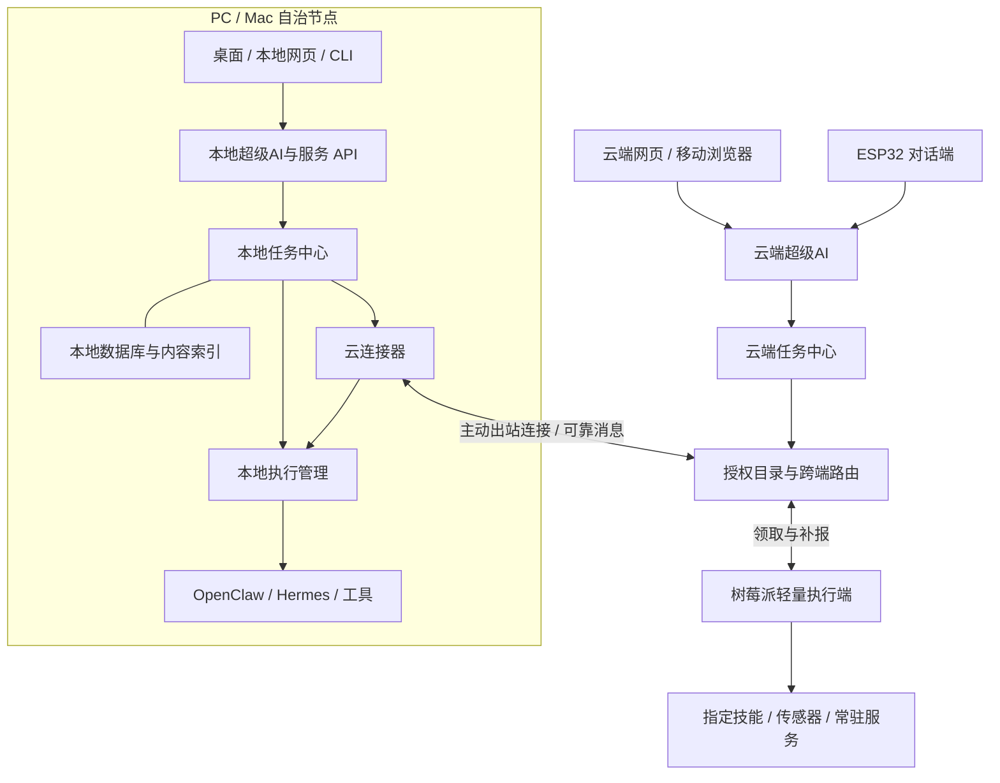

# AgentCenter 多端自治升级改造方案

版本：设计稿 v1.0 · 日期：2026-10-13

目标项目：`/Users/expeqiu/Library/Mobile Documents/com~apple~CloudDocs/WaytoAI/AgentCenter`

状态：方案交付，尚未实施。产品定位已由用户确认；协议、表结构、默认参数和排期顺序是本方案的设计建议，不代表现有能力。

## 1. 目标与交付边界

将 AgentCenter 从单协调器加设备连接器，升级为「云端全局中心 + PC/Mac 自治中心 + 树莓派轻量执行端 + ESP32 对话端」。

已经确认的产品要求：

- 云端部署超级AI、任务与调用中心。
- PC/Mac 是重型全功能端，必须具备独立自治能力。
- 树莓派承担轻量功能。
- ESP32 只对接超级AI对话，不执行 Agent 任务。

第一版的完成标准：

1. PC/Mac 不连接云端也能启动、建任务、运行本机可用执行器、查看历史和本地内容。
2. PC/Mac 联网后能接受云端委托，也能经云端请求另一台已授权设备执行。
3. 断网、重复投递和服务重启不造成同一执行请求被无条件重复启动；无法判断的执行进入待核实状态。
4. 取消有请求、送达、停止确认的完整语义，设备未确认时不宣称已停止。
5. 私有任务、对话与文件不因连接云端而自动上传。
6. 树莓派能持久化任务与结果；ESP32 只能访问授权会话和关联任务。
7. 现有 CLI、任务界面和历史数据有明确兼容与迁移路径。

本轮不引入跨云联邦、任意设备点对点网络、全量数据库双向同步、完整文件同步、自动迁移正在执行的进程或无限递归的 Agent 调用。

“独立自治”分为两层：脱离 AgentCenter 云端仍可运行是必需能力；完全断开互联网后能否推理，取决于本机是否安装离线模型或具备不依赖网络的执行器。界面必须区分这两种情况。

## 2. 当前基础与改造原因

源码评估基线：当前项目已有 FastAPI 后端、Next.js 控制台、OpenClaw/Hermes 适配器、SQLite、Tauri 桌面、独立 fleet-edge 和 ESP32 固件。前序隔离验证中，77 项后端及连接器测试通过；前端排除重复生成目录后源码类型检查通过。这些结果不等于真实跨机验收。

| 当前实现 | 改造方向 |
|---|---|
| `TaskRecord.node_id` 同时承载派单目标语义 | 明确任务归属、路由委托与执行记录 |
| 本机任务由内存 `asyncio.create_task` 启动 | 从持久化执行记录恢复与派发，保存运行句柄 |
| 远端领取直接变为 running | 增加接收确认、执行阶段、幂等和故障核实 |
| 远端取消只设置中心内存标记 | 持久化取消命令，由执行端停止并确认 |
| fleet-edge 上报失败只记日志 | 本地结果与事件持久化，收到确认前保留 |
| SSE/WS 共用消费队列 | 持久化游标读取或每订阅者独立缓冲 |
| 桌面 sidecar 随应用退出 | 后台节点服务与桌面窗口分离 |
| `mode` 混合 local/plugin/webhook/voice | 分开部署配置、角色、连接方式、硬件类型 |
| 普通管理 API 无统一鉴权 | 管理员、节点、对话设备分开授权 |
| 超级AI依赖客户端携带 pending | 服务端保存确认单，绑定主体、会话和有效期 |
| 内容默认路径含特定用户目录 | 首次配置本机目录，云端默认不挂载个人目录 |

不能把当前功能直接复制到每台机器后只增加同步接口：否则会出现重复派单、任务状态冲突、云端误读取本机路径等问题。

## 3. 部署形态与能力矩阵

| 能力 | 云端中心 | PC/Mac 自治中心 | 树莓派轻量端 | ESP32 |
|---|---|---|---|---|
| 超级AI | 全局入口 | 本地入口，在线可请求云端协助 | 不默认部署 | 对话客户端 |
| 权威任务中心 | 云端归属任务 | 本机归属任务 | 无用户级任务中心 | 无 |
| 跨端调用 | 路由、授权、进度汇总 | 发起及接受委托 | 接受许可范围内的委托 | 通过对话发起 |
| 执行器 | 默认关闭，可显式启用云执行器 | 本机完整运行时及工具 | 按硬件安装指定执行器 | 无 |
| 数据持久化 | 任务、目录、委托和审计 | 本地任务、执行记录、内容索引 | 执行日志、命令收件箱、结果发件箱 | 必要凭据与会话恢复标识 |
| 本地知识/技能/文件 | 仅云端明确配置的资源 | 完整支持 | 仅选择的技能与资源 | 无 |
| UI | 全局 Web 控制台 | 桌面与本地 Web/CLI | CLI/简易状态页按需 | 按键、屏幕、语音按硬件配置 |
| 无云运行 | 不适用 | 必需 | 已接收任务及既有常驻服务 | 默认提示云端不可用 |

建议配置名称：`cloud`、`full`、`edge`；ESP32 为独立固件类型 `conversation`。硬件类型不能代替能力声明：高配树莓派可安装额外执行器，未安装浏览器工具的 PC 不应接浏览器任务。

“PC”所覆盖的操作系统尚未确认。方案保留 Windows/Linux/Mac 适配边界；先完成现有 macOS 路径，再对明确选定的系统做安装与运行验收，不能把 macOS 打包通过视作 Windows 已支持。

## 4. 目标架构



沿用一个代码库，按配置组装模块；初期每个中心使用一个后端服务和一个本地数据库。以已有 SQLite 承载首版单实例，不同时引入新数据库、消息中间件和微服务。多副本云端需要另行完成数据库并发控制、调度排他及共享存储验收，不能直接增加 Web worker 数量。

PC/Mac 上只允许一个受管理的后台节点服务；桌面和 CLI 都连接该服务。云连接器是该服务的模块，不再启动第二套 fleet-edge 进程抢同一个运行时。独立 fleet-edge 保留给轻量端。

## 5. 任务归属与跨端委托

### 5.1 三个核心对象

| 对象 | 所有者 | 含义 |
|---|---|---|
| Task | 创建该任务的中心 | 用户目标、权限、取消意图与最终业务状态 |
| Delegation | 路由中心 | 某个子步骤交给某节点的请求与投递状态 |
| Execution | 实际执行节点 | 某次运行尝试、进程、输出和停止结果 |

本地直接执行的 Task 也创建 Execution，只是不产生跨端 Delegation。云端直接向 Mac 派单时，云端拥有 Task 和 Delegation，Mac 只拥有 Execution，不额外创建同权的业务任务。Mac A 请求 Mac B 时，A 拥有 Task，云端拥有路由 Delegation，B 拥有 Execution。三方通过引用关联。

云端收到的本地任务摘要是只读投影；云端执行记录是对远端事实的投影，不能直接覆盖远端进程状态。用户通过云端操作本地归属任务，必须转为发给归属中心的命令，且具有显式授权。

### 5.2 身份与关联

- `node_id`：首次安装生成的稳定随机 UUID，不以主机名充当身份；重命名不改 ID。
- `owner_center_id + task_id`：任务的全局归属引用；已有 task UUID 可保留。
- `delegation_id`：一次子任务委托，重投不改变；新业务步骤使用新 ID。
- `execution_id + attempt`：执行记录及运行尝试，断网补传不增加 attempt。
- `root_task_ref / parent_task_ref / trace_id`：串联跨端调用链，不能作为授权依据。
- `workspace_id`：只在归属中心内有意义。跨中心使用显式映射，不凭相同 slug 自动视为同一工作区。

首版每个自治中心最多绑定一个云端组织/中心，可对应其中多个授权工作区。纯本地工作区无需映射即可工作。重新绑定云端不转移旧任务归属。

### 5.3 典型路径

**本地任务**：本地输入 → 本地确认与授权 → 本地 Task/Execution → 本机执行 → 本地结果；整个路径不依赖云端。

**云端委托**：云端输入 → 云端确认 → 云端 Task/Delegation 持久化 → Mac 拉取 → Mac 持久化 Execution 并确认接收 → 执行 → 结果补报 → 云端更新其 Task。

**Mac A 请求 Mac B**：A 的本地任务创建子步骤 → A 向云路由提交请求 → 云端验证双方工作区和能力授权 → B 接收执行 → 云端转交结果 → A 收敛父任务。任一方离线则等待，不把 A 的父任务归属转移给云端。

**ESP32 发起任务**：设备对话 → 云端建立会话与确认单 → 确认后建云端任务 → 选择执行端 → 设备恢复同一会话获取结果。ESP32 无任务领取权限。

首版限制跨端委托深度，建议最多 3 层，并校验祖先链防止 A→B→A 循环；默认由任务所属中心规划子步骤，执行器不获得任意跨端调用权限。

## 6. 状态、离线与故障语义

### 6.1 分开记录三个维度

- Task：`queued / running / succeeded / failed / cancelled / needs_attention`。
- Execution：`accepted / starting / running / succeeded / failed / stopped / interrupted / unknown`。
- Delivery：`pending / acknowledged / retry_wait / blocked`。
- 取消额外字段：`cancel_requested_at / cancel_ack_at / stopped_at`。
- 连接状态独立记录：在线、离线、最后见到时间。离线不等于失败；上报失败不等于执行失败。

API v1 仍输出 `completed` 等旧状态；内部新状态经过兼容映射输出，无法表达的恢复细节通过附加字段说明。API v2 返回完整维度。

### 6.2 取消与完成竞争

1. 所属中心持久化取消命令，界面显示“请求取消”。
2. 执行端确认收到，显示“正在停止”；排队任务可直接停止，运行任务调用执行器取消。
3. 进程树/运行时会话已停止后回报 `stopped`，所属中心才标记 `cancelled`。
4. 若执行已完成再收到取消，返回 `already_finished`，保留完成事实；若已停止后收到迟到的重复完成消息，不覆盖停止记录。
5. 执行无法停止或状态不可判定，显示“需要处理”，不能仅修改数据库以伪造停止。

本地执行器保存 PID 之外还要保存进程启动标识、运行时会话 ID 或可核验句柄，防止重启后因 PID 复用误杀无关进程。按操作系统实现进程树管理。

### 6.3 离线与重启

| 故障 | 行为 | 恢复 |
|---|---|---|
| 云端不可用 | Full 继续本地任务；跨端步骤等待 | 同步未确认消息 |
| Full 与互联网断开 | 本地工具/离线模型继续；在线依赖等待或按超时失败 | 重新检查依赖再运行，不声称离线模型自动可用 |
| 远端领取后断网 | 默认继续已接受的离线允许任务 | 按顺序回传进度与结果 |
| 结果上报时丢失响应 | 保留同一个结果消息并重发 | 接收端去重并返回确认 |
| 本地服务重启 | 查持久化 Execution 与真实运行句柄 | 可接管则接管；无法确定则 `unknown`，要求核实 |
| 云端重启 | 从数据库恢复待投递与待确认记录 | 不根据内存丢失重新创建任务 |
| 设备长时间失联 | 委托显示待核实 | 不自动把可能仍在执行的写任务派给另一台机器 |
| 凭据吊销 | 停止新命令与新同步 | 离线端只能在下次连接获知吊销；已运行任务按预置策略处理 |

**租约失效不代表旧执行已停止。** 首版以不重复产生外部副作用为优先：领取租约控制并发接收，但失联后不自动迁移已接受的执行。只读或明确幂等的任务可按声明允许重试；支付、发布、发消息等外部写操作默认需要核实。支持 fencing 的资源可使用递增 attempt token 拒绝旧尝试，但不能把 token 当成所有第三方系统都支持的能力。

## 7. 可靠通信与协议

### 7.1 传输选择

沿用 HTTPS/JSON 和设备主动出站领取，首版不要求入站公网端口。轮询或长轮询负责领取，批量 HTTP 上报负责补传；SSE 用于界面订阅。现有 webhook 作为兼容传输，必须进入同一个收件箱和幂等流程，不能绕过执行接收逻辑。

### 7.2 消息信封

```json
{
  "protocol_version": 2,
  "message_id": "uuid",
  "type": "execution.completed",
  "source_node_id": "node-uuid",
  "target_center_id": "center-uuid",
  "owner_center_id": "owner-uuid",
  "task_id": "task-uuid",
  "delegation_id": "delegation-uuid",
  "execution_id": "execution-uuid",
  "attempt": 1,
  "sequence": 12,
  "trace_id": "trace-uuid",
  "occurred_at": "2026-10-13T08:00:00Z",
  "payload": {}
}
```

所有者、来源和目标字段需与已认证主体及委托授权匹配，不能信任请求体自报身份。顺序以同一 execution 的 sequence 判定，不使用设备时间戳做冲突裁决。

### 7.3 投递与幂等

- 业务状态更新与 outbox 消息在同一数据库事务中提交。
- 接收方在同一事务内写 inbox 去重记录、Execution 或投影更新，再返回 ACK。
- `message_id` 用于消息去重；`delegation_id + attempt` 用于执行接收去重；用户请求另有按主体限定的 idempotency key。
- 相同幂等键但不同请求内容返回冲突，不静默复用旧结果。
- 接收确认前不从发件箱删除消息；连接失败指数退避并加抖动。
- 协议按至少一次投递设计，不承诺任意外部副作用恰好一次。
- 允许乱序缓存或返回缺失序号；旧事件不能把最终状态回滚。
- 日志分块、设置额度和保留期，终态与结果不得因普通日志溢出被丢弃；磁盘不足时拒绝接新任务并告警。
- ACK 明确到消息或连续序号，不能因收到某条较新事件而默认更早事件全部收到。

### 7.4 拟增 API 契约

| 接口 | 调用方 | 作用 |
|---|---|---|
| `POST /api/v2/enrollments` | 管理员 | 生成短时、限次、带角色约束的登记凭证 |
| `POST /api/v2/nodes/enroll` | 新节点/设备 | 换取独立身份与凭据 |
| `POST /api/v2/nodes/heartbeat` | 已登记节点 | 上报版本、能力摘要、健康和容量 |
| `POST /api/v2/delegations` | 已授权中心 | 幂等创建跨端委托 |
| `POST /api/v2/commands/claim` | 执行节点 | 领取投递命令，含派单、取消等 |
| `POST /api/v2/commands/ack` | 执行节点 | 确认命令已持久化，非执行完成 |
| `POST /api/v2/events/batch` | 节点/中心 | 批量上传事实事件与结果，逐项 ACK |
| `GET /api/v2/tasks/{id}/events?after=` | 有权限的 UI/CLI | 持久化游标回放和实时订阅 |
| `POST /api/v2/tasks/{id}/cancel` | 任务授权主体 | 幂等提出取消 |
| `POST /api/v2/conversations/{id}/turns` | 对话主体 | 提交文本、获取确认单或回复 |
| `POST /api/v2/confirmations/{id}/confirm` | 确认单所属主体 | 一次性确认，创建任务 |

会话创建、查询、令牌轮换和结果读取配套设计；最终 OpenAPI 在 P0 固化。ESP32 不能访问 claim、delegations 或管理 API。未知主协议版本拒绝派单，兼容小版本以能力协商处理。

## 8. 能力目录与调度

能力声明至少包括：`capability_id`、运行时与 agent 标识、版本、资源要求、是否依赖互联网、是否产生外部写入、是否支持取消/恢复、允许的工作区和并发上限。

能力示例：`agent.openclaw`、`agent.hermes`、`tool.browser`、`tool.files`、`sensor.read`、`conversation.text`。声明描述具体执行器，不使用“电脑=什么都能做”的推断。

调度顺序：

1. 验证发起主体、工作区映射、任务共享范围。
2. 验证能力授权、执行端允许的目录/工具与资源条件。
3. 检查依赖是否可用、是否允许离线执行及排队时限。
4. 用户指定节点则尊重指定；不可用时等待或明确失败，不默默换设备。
5. 自动选择先满足数据位置约束，再比较空闲槽位和运行时健康。
6. 接收端再次验证能力与容量；目录过期不意味着必须接单。

本地任务默认本地执行。借用远端能力需要明确共享策略和跨端权限。中心分配与节点接收都要做容量控制；可从 full 默认 3、edge 默认 1 个槽位起步，最终按硬件压测配置。云端缺省没有本地 Agent 执行槽位。

## 9. 数据结构与同步边界

| 数据对象 | 关键字段/约束 | 部署位置 |
|---|---|---|
| 本机身份 | node_id、profile、schema/protocol 版本 | 每个服务节点 |
| 节点名册 | 角色、连接方式、硬件、能力、容量、最后在线 | 云端及本地必要缓存 |
| tasks（扩展） | owner_center_id、origin、visibility、cancel_requested_at、revision | 归属中心 |
| delegations（新增） | owner/task_ref、目标节点、幂等键、投递状态、授权快照 | 路由中心 |
| executions（新增） | delegation/local_task_ref、attempt、状态、运行句柄、序号 | 执行端；中心保存只读投影 |
| inbox/outbox（新增） | message_id、payload、ACK、重试时间；唯一键 | 所有可靠消息端 |
| task_events（扩展） | event_id、execution_ref、sequence、结构化状态 | 归属中心及执行端 |
| conversations/confirmations（新增） | 主体、会话、动作摘要、有效期、消费状态 | 对话所在中心 |
| grants / workspace_links（新增） | 主体、能力范围、远端工作区映射 | 双方中心 |
| artifact_refs（新增或扩展） | 所有者、hash、类型、大小、访问策略、传输状态 | 原端及授权索引 |

Task 终态更新采用 revision 条件更新；执行接收用数据库唯一约束去重，不能仅依赖进程内 Lock。首版调度器单实例，升级多 worker 前完成跨进程验证。

| 内容 | 默认策略 |
|---|---|
| 本地私有任务、对话、知识库和技能正文 | 留本地，不自动上传 |
| 本地任务的云端展示 | 用户可选关闭、仅元数据、摘要；元数据也按授权过滤 |
| 云端委托的输入与结果 | 创建时告知共享范围，按该委托授权传输 |
| 能力目录 | 只上报获准公开的能力与必要资源信息 |
| 大文件输出 | 先传引用；显式授权后按额度传输，使用 hash 验证 |
| 本地绝对路径 | 不当作跨端可访问 URL，默认不向云端公开 |
| 密钥、环境变量、模型凭据 | 留所属端安全存储，不进入任务快照或同步 |

原有 WaytoAI 全量同步脚本不再作为自治节点默认注册流程；已存在的人工同步保留为独立运维能力，需明确目录范围。数据库、日志、构建缓存应放在各节点本地应用数据目录，不通过 iCloud 同步正在使用的数据库。

## 10. 超级AI与 ESP32

复用现有白名单服务及规则路由作为可验证基线。超级AI只生成受约束的服务请求，由任务和授权层决定能否执行；后续若接模型理解，也不能直接越过这些边界。

云端入口默认创建云端归属任务，本地入口默认创建本地归属任务。界面固定展示当前中心与任务执行位置，确认文案显示目标设备、工作区和将发送的数据范围。

确认单由服务端持久化，包含 `confirmation_id`、主体、会话、任务摘要、目标、授权范围、有效期及内容摘要。客户端只回传确认标识；重复确认返回同一任务，跨会话确认拒绝；修改任务内容必须重新确认。纯本地确认依赖本地服务，不依赖云端。

ESP32 首版延续文本协议：按钮/串口输入或已有转写文本 → 超级AI → 文本回复/任务结果。当前固件不能因此被表述为已完成麦克风识别与语音播报。真实语音需要单独确定麦克风、音频编码、ASR/TTS 服务或本地网关、音频额度与端到端延迟，再做硬件验收。

对话设备的任务查询必须验证该任务与当前设备会话或用户授权关系，不能仅验证 token 有效后按任意 task_id 读取。默认云端断开时提示不可用，不自动切换到陌生局域网中心。后续如需 Mac 本地语音入口，作为显式配对能力增加。

## 11. 身份与访问控制

- 区分用户管理员、自治中心、轻量执行节点、对话设备四类主体。
- 初版可限定单组织使用，但必须有身份与工作区访问检查，不能依赖“地址不公开”。
- 云端 Web 管理会话使用合适的登录会话与 CSRF 防护；CLI 使用个人访问令牌；具体登录提供方留待部署环境确认。
- 节点登记使用短期、限次、角色受限的凭证，登记成功后每节点独立凭据，可轮换与吊销。
- 本地 API 默认只监听 loopback，并要求本地会话认证；桌面通过受控引导获得凭据，不把凭据写入 URL。CORS 仅允许实际使用的入口来源。
- 本地 Web/CLI 与桌面共用授权服务；如开放局域网访问，需要独立启用认证与 TLS，不自动监听全部网卡。
- 执行端授权与云端授权取交集，云端管理员不能默认扩展本机文件和工具权限。
- TLS 用于跨端传输；如保留 webhook，签名覆盖正文并校验时效、重放和消息 ID。
- 跨端任务按委托传递最小权限；审计记录谁在什么中心调用了哪个节点、哪个能力及确认结果。

安全验收必须覆盖横向读取其他设备任务、伪造 owner/source、越工作区派单、重复确认、凭据吊销及未授权管理 API。

## 12. 桌面、轻量端与运维改造

### Full

- 后台节点服务独立于 Tauri 窗口。关窗不停止任务；提供明确的“停止节点服务”操作及运行中任务提示。
- 根据支持的操作系统实现用户级服务安装、升级、日志与重启。首版不以端口号直接杀死任意占用进程。
- UI/CLI 发现同一后台服务，版本不兼容时提示升级，不偷偷启动第二套服务。
- 代码、依赖、数据库和内容目录分开；去除写死的用户名路径，首次运行选择内容目录。
- 启动服务不自动更新依赖；依赖锁定与安装发生在打包/升级阶段。

### Edge

- 保留独立轻量包，增加标准库 SQLite 收件箱、执行日志和结果发件箱，不强制安装 Next.js/Tauri/全量知识模块。
- 后台运行，默认单任务；工具和运行时按需安装。
- 常驻传感器/局域网服务与有终态的任务执行分开：注册健康检查和有限动作，避免将永久服务伪装成永不结束的任务。

### Cloud

2026-10-14 收窄：云端只部署协调器，`DEPLOY_PROFILE=cloud`。执行槽位为 0，不扫描 OpenClaw / Hermes。能力声明只有 `conversation.text`。本机完整版仍是 `full`。

云上必须有这些，缺一则多台机器无法协作：

| 能力 | 云上做什么 |
|---|---|
| 超级AI 全局入口 | 网页与 ESP32 对话；服务端确认单；确认后才建云端任务 |
| 云端任务中心 | 只拥有从云端或语音端创建的任务，汇总进度和终态 |
| 设备名册 | 短时登记凭证、每台独立令牌、心跳、在线状态、能力目录 |
| 跨端路由 | 授权、工作区映射、委托、选节点；指定设备不可用就等待或失败 |
| 可靠消息 | 领取、确认、结果补报、取消送达；重复投递不重复启动 |
| 四类身份 | 管理员、自治中心、轻量执行端、对话设备分开授权 |
| 审计 | 谁在哪个中心调用了哪台设备、哪个能力、确认结果 |
| 协调器健康 | 服务存活、库可写、调度在跑、未确认消息积压 |

控制台只留超级AI、云端任务、多端、信息链、协调器状态。ESP32 只走对话和授权结果，不领任务。

云上不部署：本机执行器、文件与浏览器工具、个人知识库、技能正文、输出物目录、小队、Autopilot、Kanban、本机会话、Gateway/Cron 修复、Tauri。`scripts/sync-waytoai.sh` 不再作为云端注册流程；不把 WaytoAI 同步进协调器，也不写入 `content_roots.json`。私有任务、对话和文件留在 `full`。云上可见的本地任务，最多是用户授权后的元数据或摘要。密钥和模型 Key 留在各自那一端。

进程与数据：

- 单实例 FastAPI 加静态前端。SQLite 放服务器本地盘 `/opt/agentcenter/data`，日志放 `/opt/agentcenter/logs`。
- `HOST=0.0.0.0`，TLS 放在反向代理。首版单中心、单组织。
- 环境：`DEPLOY_PROFILE=cloud`、`LOCAL_EXECUTOR_SCAN=off`、`FLEET_ENROLL_TOKEN`、超级AI 的地址/模型/Key。知识库、技能、输出物路径留空。
- `GET /api/health` 的 `deploy_profile` 为 `cloud`。OpenClaw / Hermes 不可用是预期，不据此判协调器故障。
- 备份用一致性数据库备份。恢复后保留本机身份；禁止两台活跃节点共用一个 `node_id`。

验收：网页和 ESP32 能对话并确认建任务；已登记的 `full` 节点能领取并回写；重启后待投递和确认单仍在；云端库和日志里没有本机绝对路径和个人正文。

## 13. 代码改造映射

下列新文件是建议边界，按功能迁移创建，不先批量建立空模块。

| 现有位置 | 改造内容 |
|---|---|
| `backend/app/config.py` | 部署 profile、离线策略、服务模块启用、节点身份配置 |
| `backend/app/main.py` | 按 profile 组装服务、统一认证、恢复与关闭流程 |
| `backend/app/models/db.py` | 版本化迁移，补齐归属、执行、消息和授权结构 |
| `backend/app/core/task_manager.py` | 保留用户任务服务；执行恢复/取消移入 ExecutionManager |
| `backend/app/core/execution.py`（拟增） | 统一运行时执行、句柄、取消、恢复和容量 |
| `backend/app/core/fleet.py` | 逐步分离目录/授权、委托路由、连接同步；保留旧门面适配 |
| `backend/app/core/delegations.py`（拟增） | 委托幂等、目标选择和父子任务关联 |
| `backend/app/core/sync.py`（拟增） | inbox/outbox、ACK、重试、补传 |
| `backend/app/core/super_ai.py` | 本地/云端上下文、目标选择、服务端确认单 |
| `backend/app/core/device_channel.py` | 会话归属检查、设备结果访问范围 |
| `backend/app/api/tasks.py`、`ws.py` | 兼容状态映射、游标广播和断线续传 |
| `fleet-edge/src/agentcenter_fleet/edge.py` | 接入同一可靠协议、本地持久化与进程取消 |
| `frontend/src/lib/api.ts`、上下文与任务组件 | 中心/执行端分离、状态细分、离线提示 |
| `desktop/src-tauri/src/main.rs` | 从后台服务的生命周期所有者改为服务客户端/安装管理入口 |
| `scripts/start*.sh`、打包脚本 | profile、稳定数据目录、升级安装与启动分离 |
| `firmware/esp32/super_ai/super_ai.ino` | 会话恢复、确认标识、认证与错误提示 |

平台相关执行行为留在适配器；消息协议和状态机由共享契约约束。首阶段不为复用少量代码强行建立多个独立发布包。

## 14. 迁移与兼容

1. 盘点部署实例、数据库路径、运行任务、节点身份、现有反向代理和凭据；做一致性备份与恢复检查。
2. 先引入版本化迁移及新字段/表，旧读取路径继续工作；迁移脚本可重复运行但不会重复创建 Execution。
3. 为每个现存中心生成稳定 ID，将历史 Task 的 owner 设置为存储它的原中心；保存旧节点 ID 别名映射，不能按主机名跨端合并历史。
4. 历史完成任务保持只读；本机未完成任务核对运行句柄，远端运行任务与设备核对后导入执行记录。不把历史 running 一律重跑。
5. 先升级中心，再升级一台 Full 或 Edge 做协议 v2 灰度；旧节点仍走 v1 适配，但不宣称具备可靠取消和补传。
6. 同一节点同一时刻只能有一条有效领取路径；启用 v2 前停止旧领取器，v1 webhook/polling 的重投也必须受接收去重约束。
7. Web/CLI 旧接口通过兼容层访问同一任务服务；观察期完成后停止新增 v1 节点，再逐步下线旧接口。
8. 回滚前停止接新任务、排空或隔离执行并备份新数据。仅当旧版本已验证能读扩展 schema 才回滚二进制；否则恢复成套备份并核实备份后产生的执行，不能无条件覆盖数据库。

不做两套任务引擎同时写同一批任务的双写迁移。全程保留关联 ID、审计和版本，便于核对任务数量与结果。

## 15. 分阶段实施与验收

| 阶段 | 实施范围 | 必须达到的验收条件 |
|---|---|---|
| P0 契约与基线 | profile、身份/归属、状态机、OpenAPI、迁移与测试基线 | 设计契约可评审；历史库迁移可重复、备份可恢复；现有回归通过 |
| P1 单机自治可靠性 | ExecutionManager、启动恢复、取消、事件游标、后台常驻、基础认证 | 断开云端仍可本地完成任务；关窗继续；重启不盲目重跑；双窗口收到完整事件 |
| P2 云端↔Full 闭环 | 登记授权、能力目录、delegation、inbox/outbox、确认和结果补报 | 重复派单不重复启动；断网结果补报；远端取消真实停止；私有任务不上传 |
| P3 Full↔Full 协作与轻量端 | A→云→B、工作区映射、树莓派持久化和容量 | 三方链路可追踪；A 离线后能补收结果；树莓派重启恢复；跨工作区越权被拒绝 |
| P4 对话端与发布 | 服务端确认、ESP32 会话权限、安装升级、恢复演练与手册 | 确认只建一次任务；设备只能读授权结果；安装升级可重复；端到端演练通过 |

P1 是可独立发布的本地可靠版；P2 是第一个云端自治协作版；P3/P4 构成完整多端升级交付。鉴权随服务能力一起交付，不留到最后统一补做。Windows/Linux 发布如纳入范围，分别设置安装、后台服务、进程取消和升级验收，不沿用 Mac 结果。

不以未经测算的工期作为承诺。P0 完成后按实际支持的操作系统、语音硬件和人力拆估算；阶段通过后才启用下一阶段的外部能力。

## 16. 测试矩阵与发布门槛

| 场景 | 验证方法 | 通过标准 |
|---|---|---|
| 同一消息重复 100 次 | 重放相同 delegation/attempt | 仅一个 Execution 被接收；有效任务仅启动一次 |
| 用户重复确认 | 并发提交相同确认单 | 返回同一 task_id，不新增任务 |
| 接收持久化后 ACK 丢失 | 注入网络故障后重投 | 重发 ACK，不再启动 |
| 进程启动附近崩溃 | 在 starting/启动/句柄保存处注入故障 | 接管可核验进程或进入 unknown，不盲目重跑 |
| 运行中断网再完成 | 断连、执行完成、重启执行端、重连 | 结果保留且补报，中心状态最终一致 |
| 失联租约到期 | 保持旧端实际执行但断开通信 | 有副作用任务不自动迁到另一端 |
| 取消与完成交错 | 排列请求/停止/完成事件顺序 | 返回已停止或已完成的真实事实，不回退终态 |
| 多界面订阅 | 两个 SSE + 一个 WS，同步断线重连 | 所有订阅获得完整有序事件；按游标去重 |
| 节点/工作区越权 | 使用 A token 请求 B 任务与能力 | 拒绝且不泄露正文 |
| 私有内容边界 | 构造带本地路径与私有正文的任务并检查同步载荷 | 未授权内容不进入云端请求、日志和库 |
| 云端/本地各自重启 | 对待派发、运行中、待上报各阶段重启 | 待办恢复或明确要求核实，无静默丢失 |
| 存储额度耗尽 | 限制 edge/full 数据目录空间 | 停止接新任务并提示；不将未保存结果标记成功上报 |
| 升级与回滚 | 使用旧版数据库副本演练 | 历史任务可读，ID 不变，运行任务不重复 |

测试层次：状态机单元测试 → 协议契约测试 → 进程与数据库集成测试 → 两台真实设备故障注入 → 用户入口验收。Mock 通过不能替代运行时取消、操作系统后台服务和真实网络测试。

建议可调整目标：健康网络下控制状态在 5 秒内可见；支持取消的本地执行器在 10 秒内停止，否则转为待处理；断线恢复后 30 秒内开始补传。以上是验收目标而非当前性能承诺，P0/P2 按硬件和轮询策略测定最终阈值。不可协商的门槛是：不把未知当成功、不未经授权上传、不因重复投递盲目重复执行。

## 17. 待实施前确认的少量配置

以下不影响总体架构，但影响交付包与资源估算：

1. PC 首批是否包含 Windows、Linux，还是先仅 macOS？
2. 完全断互联网时是否要求模型推理？如要求，需要确定本地模型与硬件；未确定前只承诺本地任务管理和可离线执行能力。
3. 树莓派具体型号及首批要暴露的能力？未确定前按轻量单槽位、按需执行器设计，不指定内存预算。
4. ESP32 首版是否交付真实音频？若包含，需要音频硬件和 ASR/TTS 方案，不能以串口文本冒充语音验收。
5. 云端部署环境和用户规模？默认首版单中心、单组织授权；多组织隔离和多副本部署另设门槛。

推荐首先实施 P0 与 P1。稳定单机任务引擎和后台服务后，再把委托协议接上，能复用已有产品并避免把当前可靠性缺口扩散到每一端。

## 18. 源码证据索引

以下为本次方案核对过的现有文件；路径相对目标项目根目录。

- `README.md`、`guide/architecture.md`：现有定位、配置、设备模式与接口。
- `backend/app/core/task_manager.py`：本地内存派发、取消标记、事件队列。
- `backend/app/core/fleet.py`、`backend/app/api/fleet.py`：设备登记、绑定、领取与结果处理。
- `backend/app/models/db.py`：现有 task/node/event 模型和增列迁移。
- `backend/app/core/super_ai.py`、`backend/app/api/super_ai.py`：规则路由和客户端 pending 确认。
- `backend/app/core/device_channel.py`：设备认证、对话与 task_id 查询。
- `desktop/src-tauri/src/main.rs`：sidecar 启动及应用退出时清理。
- `fleet-edge/src/agentcenter_fleet/edge.py`：执行及上报失败路径。
- `backend/app/core/content_roots.py`：本地目录默认值与持久化。
- `scripts/start.sh`：启动时安装依赖、按端口停止进程的现有行为。

本方案依据仓库和本轮讨论形成，未宣称验证云服务器配置、实际局域网连通性、Windows 支持或 ESP32 音频硬件。
