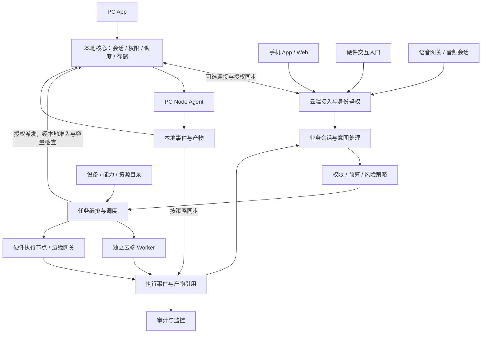

# AgentCenter 多端分离与云端统一调度方案

日期：2026-11-03。状态：当前目标设计，尚未完成实现验收。PC 独立运行已由用户明确确认为必需能力。

依据：用户提出的云端、PC、手机、智能硬件、语音多端统一接入目标，以及 [当前实现架构](architecture.md)、[项目说明](../README.md)。现状判断来自文档，尚未逐项核实代码及线上部署。

## 一、整体判断

采用“云端统一协调、PC 独立自治、多类终端接入”。云端统一管理已接入并授权共享的身份、会话、任务、资源目录、调度和审计；PC 具备完整的本地业务闭环，未接入云端也能独立使用。

云端是已接入资源的统一管理入口，也可以挂接独立的云端执行池。控制服务与执行进程隔离，重计算不得阻塞调度和会话服务。所有跨端任务经云端授权并建立任务记录；文件和音视频通过授权的数据通道传输，不必穿过调度服务进程。

“云端、PC、手机、硬件、语音”不是同一维度。云端是部署与协调位置；PC、手机、硬件是设备形态；语音是跨设备的交互通道。设备、客户端、通道、执行节点、智能体应有独立身份和关联关系。

## 二、各端职责

### 云端

- 全局入口：用户、组织/工作区、设备、会话、任务和资源视图。
- 控制：鉴权、策略、能力匹配、任务分解、并发与预算、重试、取消、审计。
- 目录：执行节点、智能体、模型服务、工具、技能版本、知识源、产物引用。
- 数据：任务与执行元数据、会话事件、授权记录；内容按存储策略归档。
- 云端执行：由独立 worker 提供，可接 GPU 或外部生成服务；协调器不隐式取得执行能力。

### PC 端

PC 是可独立运行的产品单元，包含 PC App、本地核心服务和 Node Agent。各组件可按需组合部署，界面与后台服务有独立生命周期。

PC App 负责对话、任务台、文件选择、产物查看、权限确认和节点管理。本地核心服务负责本地身份与权限、会话、任务创建与调度、知识库、技能、产物、事件和持久化。Node Agent 负责运行 OpenClaw/Hermes 等运行时、访问获准目录和应用，以及可选的云端连接、能力声明和结果回传。关闭窗口与停止后台服务是两个明确操作。

三种工作模式：

- 独立模式：无需云端账号、云端登录或云端服务即可启动、创建并执行本地任务，保存和查看结果；可配置本地模型或直接访问经授权的外部模型服务。
- 联网协同模式：接入云端，发布获准共享的能力，接受云端任务，按策略同步会话、任务与产物，并申请调用其他节点。
- 断云自治模式：云端不可达时，仍可新建、调度和执行本地任务；需要云端或其他节点的步骤明确等待或失败，不能把它们标为本地已执行。

独立运行不自动等于完全断网运行。完全断网下的模型对话、语音及工具能力，取决于是否预装相应本地模型和依赖；仅使用外部模型 API 时，不依赖 AgentCenter 云端，但仍需要互联网。

本地核心与云端核心复用领域模型和契约，通过部署配置启用不同模块。PC 有独立数据库和稳定 center_id；执行槽位、本地保留容量与云端任务额度分别控制，避免远程任务耗尽本机资源。

客户端只能调用本地受控桥接接口，不能借远程任务获得任意 shell 或全盘访问。目录授权、工具白名单、执行身份和审计落实在 Node Agent。

### 手机端

以随身入口为主：文字/语音输入、拍照与文件提交、任务进度、结果查看、通知、审批、设备配网和绑定。启动时优先实现云端能力，不把手机作为默认常驻 worker；后台限制、网络切换和耗电约束必须纳入设计。

以后可增加经明确授权的移动端能力，例如拍照、定位或分享。应用退到后台后，任务继续由云端或已分配节点执行，不能依赖手机进程存活。

### 智能硬件端

负责传感、采集、播放、指示和受控物理动作，能力按固件声明。简单终端可以只采集和对话，复杂设备才开放执行能力，不能因设备在线就认定可以承接任意任务。

急停、功率/温度限制、看门狗与断网保护在本地闭环。云端发出带有效期和权限范围的指令，本地校验后执行，回传设备实际反馈。指令已送达不等于动作已完成。

### 语音通道

作为 PC、手机、音箱、ESP32 等设备共用的交互能力，单独管理音频会话、转写、播报、打断和轮次。语音会话关联业务会话，但语音轮次不直接等同于长任务。

端侧处理采集、播放、回声控制及必要的唤醒/打断；识别、理解和合成可由云端统一路由。能力弱的终端可经受信网关接入。用户打断播报默认只停止音频，取消业务任务需单独的取消意图和权限判断。

## 三、结构与主链路

示例：用户在手机说“整理家里 PC 上的文档并生成摘要”。

1. 手机创建或续接业务会话，提交文字或音频，并携带请求去重标识。
2. 云端解析需求，检查该用户能否访问目标 PC 与指定目录，并确认敏感内容的外发策略。
3. 云端创建任务；如 PC 离线，显示等待设备和超时时间，不能静默换到没有文件的其他机器。
4. 在线 PC 的 Node Agent 取得执行租约，在授权目录读取文件；按策略在本地分析或向允许的模型发送内容。
5. 节点持续回传事件，结果保存为产物并登记引用；云端给手机展示摘要和可访问的产物。
6. 用户在 PC 打开同一会话，能看到同一任务；语音终端经授权也能播报结果摘要。

## 四、统一资源模型

不能只维护“设备在线/离线”。至少需要以下实体：

- User / Workspace：归属和隔离边界。
- Device：物理设备、配对关系、固件和生命周期。
- Client / Channel：应用安装实例与文字、语音、通知等交互通道。
- Node：执行环境、连接、健康、执行槽位和租约；一台设备可以承载多个隔离节点。
- Agent：逻辑执行角色、运行时、版本和可用节点。
- Capability：可执行操作、参数契约、版本、资源需求和约束。
- ResourceRef：本地文件、知识源、模型端点或存储资源的位置与授权引用。
- Conversation / Turn：跨端业务上下文和单轮输入输出。
- Task / Execution / Delegation：用户目标、一次运行与跨节点子步骤。
- Artifact / Event / Audit：结果、可重放事件与责任记录。

任务必须保存来源用户、工作区、源会话、目标能力、资源引用、策略版本、幂等键、超时、重试预算与追踪标识。补充 owner_center_id 与稳定任务 ID：本地创建任务由 PC 中心负责，云端创建任务由云端中心负责；同步副本不改变归属。独立模式的本地用户身份在绑定时显式映射到云端身份，不能按用户名自动合并权限。授权由服务端和执行节点共同校验，不能信任客户端自己填写的 owner 或权限。

调度先按权限、资源位置、能力版本、数据策略筛掉不合格节点，再按健康、可用槽位、排队、成本和亲和性排序。用户指定设备时保留约束；无法满足时等待或说明原因。

## 五、集中管理的数据边界

云端统一的是已授权接入资源的可见性、访问规则与生命周期，不要求全部正文集中存放。PC 独立模式先在本地保存全部业务元数据；接入后按同步范围建立云端副本，私人本地任务可不进入云端。

- 云端集中保存：云端身份与授权、已绑定节点名册、云端归属任务，以及获准共享的能力目录、技能版本元数据、资源引用、必要事件及审计。本地独立模式在本地保存对应记录。
- 按策略同步：对话历史、知识卡片、摘要、产物副本和检索索引；明确保留期、删除和访问范围。
- 默认端侧保留：完整私人目录、运行时密钥、设备驱动数据及未授权原始音频。上传和外发仍受策略约束。
- 本地资源引用包含节点身份、逻辑资源 ID 和访问范围；仅靠文件路径无法跨设备共享。
- 技能、知识和产物继续独立建模。技能发布版本、安装状态、执行环境和密钥绑定分别管理。

云端上的 ResourceRef 不代表云端必然能读到正文；PC 离线时必须明确标记不可访问。共享产物需要实际上传或由在线节点提供受控读取，不能把本地路径直接交给手机。

## 六、可靠性与离线

采用可恢复的投递和幂等执行设计，不承诺消息天然只投递一次。

- 请求幂等：同一提交重试不得创建多个业务任务。
- 领取租约：execution 有租约与续约；新一轮领取增加隔离代次，拒绝旧执行的迟到回写。
- 副作用：支付、发送消息、物理动作等使用业务幂等键和执行凭据；不能确认是否完成时进入待核实，不直接重放。
- 事件重连：事件带序号或游标，断线后补拉；端侧 outbox 持久化未确认回报。
- 取消分层：记录取消请求、通知节点、等待确认或记录无法确认；停止播报、断开网络和取消执行是不同操作。
- 节点掉线：显示最后心跳和运行状态可信度；租约过期不等于任务从未执行。
- 离线任务：PC 可依据本地权限创建并立即执行本地任务，使用中心身份加全局唯一任务 ID 标识，无需等待云端分配编号。需要远程资源的步骤排队等待；重连后用稳定任务与事件 ID 去重同步，不重新执行已完成任务。离线期间不跨端调度，不自行扩大权限。
- 硬件指令：包含有效期与状态前提；过期或重复指令拒绝执行，急停保持本地优先。

云端负责跨端协调与云端归属任务，本地核心负责本地归属任务。任务所有者负责规范状态流转，执行节点保留执行事实、日志与待回传事件。云端派发到 PC 的任务保留云端任务归属，PC 建立关联的本地执行记录，不另建一个互不相关的业务任务。

重连后由执行凭据、版本与事件合并事实，不使用最后写入覆盖全部状态。云端任务的离线执行必须受有效委托和风险策略限制；租约失效后禁止发起新的受租约约束副作用，已有动作保留证据并进入待核实，不能因此自动重派。云端故障不阻塞本地任务创建与执行。

会话通过稳定消息 ID 合并，保留并发分支；技能和配置使用版本及冲突提示；知识库修改保留修订与删除标记；产物按稳定引用和内容校验同步。解绑可停止同步与远程调用，不应删除用户本地任务和产物。

## 七、接入、安全与运维

用户身份与设备身份分开：用户会话表明“谁提出需求”，设备凭证表明“哪台设备接入”，运行时身份决定“工具以谁的权限运行”。绑定、换机、解绑、令牌撤销与执行权限回收要能独立处理。

端侧优先主动建立到云端的加密连接，不要求家庭 PC 暴露公网端口。任务 API、事件流、设备连接和音频传输可使用不同通道，复用身份与关联 ID；具体协议随硬件、网络和实时性要求选择。

云端统一模型服务目录、调用策略与费用账本。云端调用的服务密钥留在云端；本地调用密钥留在节点的安全存储，云端只持有引用和状态。

观测必须覆盖会话到任务再到执行的链路，以及调度等待、执行耗时、设备离线、事件积压、语音响应、失败原因和资源费用。指标目标在实际设备与网络基线上制定，不能把未测量目标写成保证。

先保持模块化单体控制面，后台执行独立部署；达到实际容量或团队边界后再拆服务。多副本调度前必须具备共享状态、领取互斥、租约和一致性约束，不能直接把现有内存锁复制成多实例。

## 八、与当前 AgentCenter 的关系

现有文档已经描述 cloud/full/edge、fleet-edge、语音在场终端、executions/delegations、inbox/outbox 和 owner_center_id。它们可作为演进基础，但实现完整性需通过代码与链路验证。

需要重点演进：

1. full 逻辑拆分为 PC App、本地核心与独立 Node Agent，保留过渡兼容层；本地核心必须支持不接云端的完整业务闭环。
2. 将设备形态与 voice 通道拆开，避免同一 PC 的对话和执行身份互斥。
3. 全局会话从当前网页 sessionStorage 与有限服务端历史，演进为可授权、可续接的持久会话。
4. 本地 Outputs 扩展为跨端 ArtifactRef，增加可用性、访问授权与可选副本策略。
5. cloud 从“只协调本地执行”扩展为能调度独立云端 worker；这是一项新增能力，不能宣称当前已具备。
6. 核实租约、去重、断线恢复、权限隔离与待核实行为，而不只验证正常成功链路。

2026-11-03 文档对齐已依据当前代码修正 README 与 ADR 中“所有任务先确认”“关窗即停”的旧表述。当前规则建任务与名册命中派发可直接创建，另保留确认单兼容路径；桌面退出路径不调用停止，显式停止走 `stop_node_service`。这些代码事实不代表目标可靠性或安装包已通过验收。目标权限确认由操作风险和已有授权决定，各端共享策略，本地操作在本地判定。

## 九、实施顺序与验收

第一阶段：定义身份、实体与协议，拆出本地核心与 PC Node Agent。验收：未绑定云端的新安装可独立创建、执行、查询本地任务和产物；云端不可达或登录失效不阻塞本地功能；预装本地模型与依赖时，断网也能完成对应本地链路；重启后记录仍在；PC App 退出后后台按设置继续运行；撤销云端凭证后不能领取远程任务，本地功能仍可用。

第二阶段：打通手机→云端→PC→手机的最小闭环，支持同一会话跨端续接。验收：重复提交只建一个任务，离线设备正确等待，手机能读取授权产物，跨工作区访问被拒绝。

第三阶段：补齐租约、事件补拉、去重、超时、取消和待核实。验收：注入断网、节点重启、领取超时和迟到回写，不产生重复副作用，且状态解释清晰；断云期间新建本地任务可执行，重连只同步一次；并发修改保留冲突，不覆盖本地执行事实。

第四阶段：接入语音通道和硬件网关。验收：打断播报不误取消任务，过期硬件指令拒绝执行，断网保护不依赖云端。

第五阶段：统一模型与算力资源目录、预算、配额和节点容量调度。验收：资源不可用或预算不足时拒绝或排队，并能解释选中节点的原因。

产品最终应让用户围绕同一会话、任务和资源工作；设备是任务发生与执行的位置，而不是五套彼此孤立的业务系统。

## 十、文档适用顺序与实施缺口

本文件是多端职责与 PC 自治的目标设计依据。`architecture.md` 和 README 记录当前源码行为及部署限制；日期化方案提供领域细节，冲突部分按本文件修订。历史评估只证明其注明的代码基线，不作为现状承诺。

尚需逐项验收：首次安装无云端登录的本地闭环；本地核心与 Node Agent 的实际模块划分；租约和副作用边界；会话与资源的授权同步；独立云端 worker。当前 `cloud` profile 仍保持协调器零执行槽，不通过修改文档隐式启用执行器。
